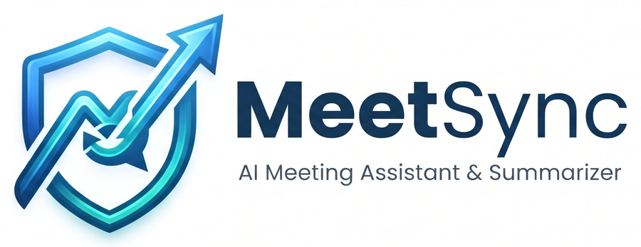

<p align="center"></p>

# MeetSync – AI trích xuất quyết định cuộc họp (MVP)

## Giới thiệu sản phẩm

**MeetSync** biến transcript một cuộc họp tiếng Việt thành biên bản có cấu trúc trong vài phút:
quyết định cuối cùng, việc cần làm (ai làm, hạn khi nào), vướng mắc, yêu cầu, vấn đề còn bỏ ngỏ và
thông tin mới. Con người duyệt lại rồi xuất ra Excel hoặc JSON.

**Dành cho ai:** người theo dõi sau họp – PM, trưởng nhóm, thư ký – những người hiện đang phải nghe
lại hoặc đọc lại cả buổi họp để viết biên bản.

**Vấn đề MeetSync giải quyết:** trong một cuộc họp, một vấn đề thường được bàn đi bàn lại nhiều lần
trước khi chốt. Công cụ tóm tắt thông thường dễ ghi nhầm một ý kiến giữa chừng thành quyết định.
MeetSync được thiết kế quanh một nguyên tắc: **không biến ý kiến trung gian thành quyết định chính thức.**

> Đầu buổi Nam đề xuất server on-premise. Lan nói on-premise vượt ngân sách, gợi ý AWS. Cuối buổi
> PM chốt AWS.
> → MeetSync ghi **"Dùng AWS" – Đã chốt**, kèm lịch sử: on-premise *Đề xuất* → *Bị thay thế*
> (lý do: vượt ngân sách quý).

### Tính năng chính

| Tính năng | Mô tả |
| --- | --- |
| Trích dẫn câu gốc | Mỗi mục trỏ về đúng câu nói (thời gian, người nói) để kiểm chứng, không phụ thuộc AI chép lại |
| Theo dõi trạng thái quyết định | `Đề xuất`, `Bị thay thế`, `Đã chốt`, `Có điều kiện`, `Hoãn`, `Chưa chốt` – kèm lịch sử thay đổi theo thời gian |
| Nhận biết câu không phải chốt | Câu đùa, "hay là…", "ừ" đứng một mình, câu thuật lại "hôm trước sếp bảo…" không được tính là chốt |
| Gộp chủ đề quay lại | "Quay lại vụ lúc nãy…" sau 30 phút vẫn được nối về đúng chủ đề |
| Kiểm tra thẩm quyền | Người không có quyền chốt mà nói "chốt" sẽ bị gắn cờ "Chưa rõ thẩm quyền" |
| Không bịa thông tin | Người phụ trách, hạn chót chỉ được điền khi có trong câu nói; thiếu thì để trống và gắn cờ |
| Gắn cờ cần xem lại | Con số/ngày tháng, thiếu người phụ trách, độ tin cậy thấp… được đưa lên đầu danh sách duyệt |
| Duyệt và xuất | Chấp nhận / Sửa / Loại từng mục, gán tên cho "Speaker N", xuất Excel (mỗi loại một sheet) và JSON |

**Cách hoạt động:** 4 agent AI chạy nối tiếp – Chia chủ đề → Trích xuất → Theo dõi quyết định →
Kiểm chứng – sau đó 8 quy tắc bằng code hậu kiểm kết quả (chi tiết ở mục [Kiến trúc](#kiến-trúc)).
Mặc định dùng OpenAI (`gpt-4.1-mini` / `gpt-4.1`), có thể chuyển sang Claude.

**Ngoài phạm vi MVP:** ghi âm/nhận dạng giọng nói, chatbot hỏi đáp, liên kết nhiều cuộc họp,
đăng nhập/phân quyền. Xem thêm [Giới hạn đã biết](#giới-hạn-đã-biết).

## Chạy thử nhanh (≈ 5 phút)

Cần Python 3.11+ và một OpenAI API key.

**1. Tải mã nguồn và cài thư viện**

```bash
git clone https://github.com/thanhdatpham938-hub/Multi_AI_for_meeting.git
cd Multi_AI_for_meeting
uv sync                          # hoặc: pip install -r requirements.txt && pip install -e .
```

**2. Điền API key**

```bash
copy .env.example .env           # macOS/Linux: cp .env.example .env
```

Mở `.env`, điền `OPENAI_API_KEY=sk-...` (các dòng khác giữ nguyên).

**3. Mở giao diện**

```bash
uv run streamlit run app/review_app.py
```

Trình duyệt mở http://localhost:8501.

**4. Phân tích một cuộc họp mẫu**

1. Ở khung **Transcript**, tải file `tests/fixtures/tc1.txt`.
2. Ở khung **Thông tin cuộc họp** bên phải, bấm *Nạp từ meeting_meta.json* và chọn `tests/fixtures/tc1.meta.json`
   (tiêu đề, ngày giờ, người tham dự tự điền).
3. Bấm **Phân tích** và chờ khoảng 15–30 giây (cuộc họp 100+ câu mất vài phút).

**Kết quả mong đợi:** mục **"Dùng AWS…" – Đã chốt**, trích dẫn câu `[41:05] Hùng (PM): OK, vậy mình chốt
dùng AWS nhé.` Bấm **›** để xem lịch sử: on-premise *Bị thay thế* vì vượt ngân sách. On-premise
**không** xuất hiện như một quyết định đã chốt.

**5. Duyệt và xuất:** bấm **›** ở từng mục → *Chấp nhận / Sửa / Loại*, hoặc **Duyệt nhanh** cho các mục
không có cờ; sau đó bấm **⬇ Excel**.

**Thử thêm các cuộc họp khác:**

| File | Thử điều gì |
| --- | --- |
| `tests/fixtures/tc4.txt` | Câu đùa, "ừ", quyết định có điều kiện, hoãn – không mục nào được "Đã chốt" |
| `tests/fixtures/tc5.txt` | Chỉ có "Speaker 1, 2" – thử ô **Gán tên người nói** ở khung bên phải |
| `test_cases_3_muc_do (1)/case1…/transcript.txt` + `meeting_meta.json` | Cuộc họp dài 102 câu, dễ |
| `test_cases_3_muc_do (1)/case2…` | 140 câu, nhiều bẫy: đổi ý nhiều lần, người không có quyền tự "chốt" |
| `test_cases_3_muc_do (1)/case5…` | 113 câu, CEO vào muộn lật lại quyết định |

Mỗi case dài có file `expected_result.md` mô tả kết quả đúng để so sánh.

**Không có API key?** Vẫn kiểm tra được toàn bộ hệ thống với dữ liệu giả lập: `uv run pytest`.

Đặc tả kỹ thuật đầy đủ: [CLAUDE.md](CLAUDE.md).

## Kiến trúc

```
Transcript (+ thông tin cuộc họp, tùy chọn)
 → [Code]    parsing.py      tách câu, gắn ID u001…, người nói, thời điểm
 → [Agent 1] segmenter       chia chủ đề, gộp các lần quay lại ("vụ lúc nãy")   MODEL_LIGHT
 → [Agent 2] extractor       ứng viên theo từng chủ đề, kể cả phương án bị bỏ    MODEL_LIGHT
 → [Agent 3] tracker         lịch sử + trạng thái cuối + độ tin cậy              MODEL_STRONG
 → [Agent 4] verifier        kiểm chứng decision/action với câu bằng chứng       MODEL_STRONG
             └─ không đạt → chạy lại Agent 2 + 3 cho chủ đề đó đúng 1 lần, vẫn sai → cờ verify_failed
 → [Code]    rules.py        8 quy tắc hậu kiểm (ID tồn tại, owner/deadline bịa, cờ…)
 → [UI]      con người duyệt: Chấp nhận / Sửa / Loại → xuất JSON, Excel
```

Bộ điều phối là hàm Python gọi tuần tự (`pipeline.py`), không dùng framework agent. Mọi lời gọi LLM
yêu cầu JSON, được kiểm tra bằng Pydantic và thử lại tối đa 2 lần kèm thông báo lỗi. Prompt nằm
trong `src/meeting_extractor/prompts/*.md`; hash của từng prompt được lưu trong mỗi kết quả.

## Cài đặt chi tiết

Yêu cầu Python 3.11+.

```bash
git clone https://github.com/thanhdatpham938-hub/Multi_AI_for_meeting.git
cd Multi_AI_for_meeting

# Cách 1 – uv (khuyên dùng)
uv sync

# Cách 2 – pip
python -m venv .venv
.venv\Scripts\activate          # Windows  (Linux/macOS: source .venv/bin/activate)
pip install -r requirements.txt
pip install -e .
```

> Windows: nếu pip báo `No such file or directory … anthropic\types\beta\…`, đường dẫn đã vượt 260 ký tự –
> đặt thư mục dự án/venv ở đường dẫn ngắn hơn hoặc bật
> [Long Path](https://pip.pypa.io/warnings/enable-long-paths).

## Cấu hình

```bash
cp .env.example .env            # Windows: copy .env.example .env
```

Mở `.env` và điền:

| Biến | Ý nghĩa | Mặc định |
| --- | --- | --- |
| `LLM_PROVIDER` | Nhà cung cấp LLM: `openai` hoặc `anthropic` | `openai` |
| `OPENAI_API_KEY` | API key của OpenAI | (bắt buộc khi dùng OpenAI) |
| `OPENAI_BASE_URL` | Endpoint tương thích OpenAI (Azure, proxy…) | để trống = api.openai.com |
| `MODEL_LIGHT` | Model cho Agent 1, 2 | `gpt-4.1-mini` (Anthropic: `claude-haiku-5-5`) |
| `MODEL_STRONG` | Model cho Agent 3, 4 | `gpt-4.1` (Anthropic: `claude-sonnet-5-5`) |
| `ANTHROPIC_API_KEY` | API key của Anthropic | chỉ cần khi `LLM_PROVIDER=anthropic` |
| `LLM_TEMPERATURE` | Nhiệt độ | `0` – chỉ gửi cho model còn hỗ trợ (xem Giả định) |
| `RUNS_DIR` | Thư mục lưu kết quả | `runs/` |

`.env` và `runs/` đã nằm trong `.gitignore`.

## Chạy từ dòng lệnh

```bash
# Phân tích một transcript (meta là tùy chọn)
uv run python -m meeting_extractor.cli run tests/fixtures/tc1.txt --meta tests/fixtures/tc1.meta.json

# Xuất kết quả: Excel chỉ gồm các mục đã duyệt (accepted/edited)
uv run python -m meeting_extractor.cli export runs/<run_id> --format xlsx
# Xuất cả mục chưa duyệt, có cột "Duyệt" để duyệt ngay trong Excel
uv run python -m meeting_extractor.cli export runs/<run_id> --format xlsx --all
uv run python -m meeting_extractor.cli export runs/<run_id> --format json
```

(Dùng pip thì bỏ tiền tố `uv run`.)

Mỗi lần chạy tạo thư mục `runs/<run_id>/` gồm `result.json`, đầu ra trung gian từng agent
(`segment.json`, `extract_<topic>.json` gồm extract/track/verify và vòng làm lại), `usage.json`
(token, chi phí ước tính) và `reviews.json` (các chỉnh sửa của người duyệt).

### Định dạng transcript

```
[05:12] Nam: Em đề xuất mình dùng server on-premise.
[41:05] Hùng (PM): OK, vậy mình chốt dùng AWS nhé.
```

Dòng không khớp định dạng (ví dụ `(mọi người gật đầu)`) được bỏ qua kèm cảnh báo. File `.vtt`
lấy mốc thời gian bắt đầu và tên người nói từ `<v Tên>` hoặc tiền tố `Tên:`.

Thông tin cuộc họp (tùy chọn) – `meeting_meta.json` hoặc nhập trên giao diện:

```json
{
  "title": "Họp dự án X",
  "date": "12/04/2025", "start_time": "14:00", "end_time": "15:30", "project": "Dự án X",
  "agenda": ["Chọn hạ tầng", "Lịch ra mắt beta"],
  "participants": [{"name": "Hùng", "role": "PM", "can_decide": true}]
}
```

Không có meta hệ thống vẫn chạy; khi đó không kiểm tra thẩm quyền chốt (trừ người nói dạng "Speaker N").

## Giao diện duyệt (Streamlit)

```bash
uv run streamlit run app/review_app.py
```

Mở http://localhost:8501, rồi:

1. **Trang chủ – Phân tích mới**: tải transcript (.txt/.vtt). Ở khung **Thông tin cuộc họp** bên phải,
   nhập tiêu đề, ngày, giờ, dự án, chương trình họp và người tham dự (tick "Quyền chốt" cho người có
   quyền quyết định), hoặc nạp sẵn từ `meeting_meta.json`. Bấm **Phân tích** – tiến trình từng agent hiện trực tiếp.
2. **Trang cuộc họp**: thẻ tổng hợp, các tab Tổng quan / Quyết định / Việc cần làm / Vấn đề còn mở /
   Vấn đề khác. Mục có cờ hoặc độ tin cậy thấp nằm trên đầu; cờ hiện dạng badge màu.
3. Bấm **›** ở một mục để xem nguyên văn câu bằng chứng (thời gian, người nói), timeline lịch sử,
   và **Chấp nhận / Loại / Sửa** (nội dung, trạng thái, điều kiện, người phụ trách, hạn chót).
   **Duyệt nhanh** chấp nhận mọi mục không có cờ và độ tin cậy ≥ 70%.
4. Khung bên phải: thông tin cuộc họp, **gán tên cho "Speaker N"** (áp dụng cho toàn bộ mục),
   tiến độ duyệt, cảnh báo.
5. **⬇ JSON** (toàn bộ, đã áp dụng chỉnh sửa) và **⬇ Excel** (chỉ mục Chấp nhận/Đã sửa, mỗi loại một sheet).
   Chỉnh sửa được lưu ngay vào `runs/<run_id>/reviews.json`.

## Kiểm thử

```bash
uv run pytest            # 83 test, không gọi API, không cần API key
```

Test offline dùng `FakeLLM` (trả JSON kịch bản) cho parser, LLM client (retry/validate), từng agent,
vòng làm lại, 8 quy tắc, pipeline đầu-cuối, CLI, xuất file, metrics và giao diện Streamlit (`AppTest`).

## Đánh giá

```bash
uv run python eval/run_eval.py               # chạy tests/fixtures/tc1..tc7 với API thật
uv run python eval/run_eval.py --repeat 3    # + độ ổn định qua 3 lần chạy
uv run python eval/run_eval.py --cases tc1,tc4 --no-llm-match
```

Bảng chỉ số in ra màn hình và lưu ở `eval/results/latest.md` / `latest.json` (kèm token, chi phí ước
tính, hash prompt, run_id). Khớp mục với đáp án: cùng `type` và giao nhau ở `evidence`; nếu không,
hỏi một LLM nhỏ câu có/không (`prompts/match.md`).

| Chỉ số | Ngưỡng |
| --- | --- |
| Tỷ lệ chốt nhầm | ≤ 5% |
| Recall quyết định | ≥ 85% |
| Precision việc cần làm | ≥ 80% |
| Độ chính xác trích dẫn | ≥ 95% |
| Owner/deadline bịa | 0 |
| Độ ổn định (`--repeat 3`) | ≤ 10% |


## Bộ dữ liệu kiểm thử (`tests/fixtures/`)

| Ca | Tình huống | Kỳ vọng |
| --- | --- | --- |
| TC1 | Đề xuất on-premise → chốt AWS | AWS `confirmed` (u019), on-premise `superseded` trong lịch sử |
| TC2 | Việc có/không có hạn | Minh – thứ Sáu; "ai đó cần xem lại" → owner null + `missing_owner` |
| TC3 | Quay lại chủ đề sau 30 phút ("cái đó") | Một chủ đề; 1/11 `superseded`, 15/11 `confirmed` |
| TC4 | Đùa, "ừ", điều kiện, hoãn | Không có `confirmed`; gói B `conditional`; ngân sách `deferred` |
| TC5 | Chỉ có "Speaker N" | React có cờ `authority_unclear`, confidence ≤ 0.6; owner "Speaker 2" |
| TC6 | Lỗi ASR ở con số | "30 triệu" `confirmed` + cờ `number_check` |
| TC7 | Cử chỉ + cuộc họp trước | Không có `confirmed` bịa cho "phương án đó" |

Mỗi ca gồm `tcN.txt`, `tcN.expected.json` và (trừ TC5) `tcN.meta.json`.

### Bộ cuộc họp dài (`test_cases_3_muc_do (1)/`)

Năm cuộc họp 100–140 câu, thời gian liên tục, mỗi bộ gồm `transcript.txt`, `meeting_meta.json` và
`expected_result.md` (đáp án và tiêu chí đạt dạng văn bản để người đọc đối chiếu; bộ eval tự động
chưa chấm được các case này).

| Case | Mức độ | Nội dung |
| --- | --- | --- |
| case1 | Dễ | Sprint planning, đổi MoMo → VNPay, việc có người và hạn rõ (102 câu) |
| case2 | Khó | Ra mắt trà sữa: đổi kênh quảng cáo nhiều lần, chủ đề quay lại sau 20 phút, người không có quyền tự "chốt" (140 câu) |
| case3 | Rất khó | Transcript ASR thô, chỉ có "Speaker N", số sai, nội dung nằm ngoài cuộc họp – thất bại có chủ đích (110 câu) |
| case4 | Trung bình | Khai trương chi nhánh cà phê: quyết định có điều kiện, hoãn, quay lại chủ đề, việc bị giao lại (107 câu) |
| case5 | Khó | Hậu kiểm sự cố + Black Friday: ba người có quyền chốt, CEO vào muộn lật quyết định (113 câu) |

## Giới hạn đã biết

- **TC6 – số sai do ASR:** hệ thống chỉ đọc văn bản nên ghi đúng "30 triệu" như transcript và gắn cờ
  `number_check`; **không thể phát hiện số sai khi không có audio**. Người duyệt chịu trách nhiệm kiểm tra.
- **TC7 – cử chỉ và cuộc họp trước:** "mọi người gật đầu" không có trong lời nói, "phương án đó" nằm
  ở cuộc họp tuần trước. Hệ thống không biết nội dung đó; yêu cầu chỉ là không bịa và không `confirmed`
  (bỏ sót hoặc `open` đều chấp nhận được).
- Không xử lý audio/ASR, không liên kết nhiều cuộc họp, không có chatbot hỏi đáp, không đăng nhập/phân quyền.


## Cấu trúc thư mục

```
src/meeting_extractor/
  config.py  models.py  parsing.py  llm.py  rules.py  pipeline.py  export.py  cli.py
  prompts/   segment.md  segment_merge.md  extract.md  track.md  verify.md  match.md
  agents/    segmenter.py  extractor.py  tracker.py  verifier.py  common.py
app/review_app.py        giao diện Streamlit (.streamlit/config.toml: theme)
eval/run_eval.py         chạy bộ đánh giá      eval/metrics.py   khớp đáp án, tính chỉ số
tests/                   pytest + fixtures/ (7 transcript, đáp án, meta, 1 file .vtt mẫu)
test_cases_3_muc_do (1)/ 5 cuộc họp dài 100+ câu kèm đáp án dạng văn bản
runs/                    kết quả mỗi lần chạy (gitignore)
```
